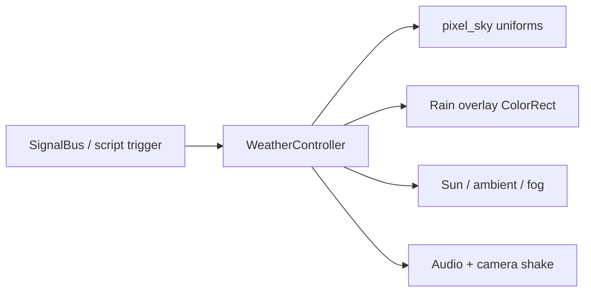

# Thunderstorm (pixel sky + rain + lightning)

## What you have today

[`Shaders/pixel_sky.gdshader`](Shaders/pixel_sky.gdshader) already draws banded fbm clouds on a flat ceiling, driven only by `day_amount` / `sun_direction` from [`Scripts/Environment/day_night_cycle.gd`](Scripts/Environment/day_night_cycle.gd). Overcast maps just bake higher `cloud_coverage` into materials ([`pixel_sky_overcast.tres`](resources/Environment/pixel_sky_overcast.tres) = 0.62, FeroShaw = 0.74). There is **no weather controller, rain, or lightning**. Fullscreen FX already exist as patterns to copy (`LoreScareFX`, `%SliceOverlay`).

Do **not** put rain streaks inside the sky shader: wrong coordinate space, and the cubemap/ambient pass must stay gradient-only so lighting does not flicker.



## Core idea: one `storm_amount` (0 → 1)

Treat weather like day/night: a single intensity the rest of the game can drive.

| Phase | Feel |
|---|---|
| 0.0 → 0.3 | Front rolls in: coverage rises from one horizon, sky desaturates, wind picks up |
| 0.3 → 0.7 | Steady rain starts; gloom deepens; occasional distant flashes |
| 0.7 → 1.0 | Full storm: heavy rain, frequent close lightning + thunder |

**Rolling in** = tween `storm_amount` over N seconds (e.g. 20–60s for drama, or a short 3–5s for scripted beats), not an instant material swap.

---

## Layer 1 — Sky mood (extend `pixel_sky.gdshader`)

Add a small `storm` uniform group; `WeatherController` sets them each frame (same pattern as `day_amount`):

- `storm_amount` (0–1)
- `storm_front` (vec2 on XZ) — unit direction the front approaches from
- `lightning_flash` (0–1, brief) — sky-side sheet-lightning only
- Optional baked storm palette uniforms: `storm_top`, `storm_horizon`, `storm_cloud_lit`, `storm_cloud_shadow`

Shader behaviour while `storm_amount > 0`:

1. **Coverage bias** — raise effective coverage toward ~0.85–0.95, but multiply by a front mask so the near horizon fills first:
   - `front = smoothstep(-0.2, 0.8, dot(normalize(dir.xz), storm_front))`
   - `coverage = mix(base_coverage, storm_coverage, storm_amount * front)`
2. **Palette** — lerp `day_top` / `day_horizon` / cloud lit/shadow toward cooler slate/green-grey storm colours; dim the sun disc (or hide it under cloud).
3. **Wind** — scale `wind` by `(1 + storm_amount * 2)` so clouds race as it arrives.
4. **Night storms** — bump effective `night_cloud_amount` with `storm_amount` so night does not clear the clouds into the space scene mid-storm.
5. **Sheet lightning in sky** — when `lightning_flash > 0`, add a banded bright lobe (cloud undersides + a bit of sky) toward a flash direction; keep this **out of** `AT_CUBEMAP_PASS` so ambient does not strobe every frame.

Baseline map materials stay as they are; storm is a runtime overlay on top of clear/overcast presets.

---

## Layer 2 — Rain (separate pixel screen shader)

New fullscreen overlay (same shape as [`Scripts/UI/LoreScareFX.gd`](Scripts/UI/LoreScareFX.gd)): `CanvasLayer` + full-rect `ColorRect`, `mouse_filter = ignore`, layer under menus (~80–90).

New [`Shaders/pixel_rain.gdshader`](Shaders/pixel_rain.gdshader) (canvas_item):

- Snap UVs to a coarse pixel grid (match CRT / `pixel_density` feel).
- Vertical streak columns via hash/noise; density and fall speed from `rain_amount`.
- Slight wind slant; optional sparse “splash” dots near the bottom of the view.
- Alpha 0 until `storm_amount` ~0.25 so rain lags the cloud front (sells “rolling in”).

Optional later: near-camera `CPUParticles3D` mist like existing `GroundMist` for depth — not required for the first readable FP look.

---

## Layer 3 — World gloom + lightning (lights, not just sky)

`WeatherController` (sibling of `DayNightCycle` on outdoor maps, or one node under `World` that MapManager retargets) multiplies what day/night already set:

- **Gloom:** scale sun `light_energy` and ambient energy down as storm rises (e.g. sun × `1 - 0.7 * storm_amount`).
- **Fog:** reuse the FeroShaw path — enable/boost `fog_density` / cool fog colour with storm (see `day_fog_density` in DayNightCycle).
- **Lightning flash (the important part for the ground):**
  1. Pick a random sky direction (or toward `storm_front`).
  2. Spike `sun_light.light_energy` (and briefly ambient) for 1–3 frames, with a second weaker echo 0.05–0.15s later (classic double flash).
  3. Set sky `lightning_flash` in sync.
  4. Emit existing `SignalBus.camera_shake_requested` for close strikes.
  5. After a distance-based delay (0.2–1.5s), play thunder via `AudioManager`.
- Flash cadence: Poisson / random timer scaled by `storm_amount` (rare at 0.4, frequent at 1.0). Distant vs close = flash strength + shake + delay.

Keep lightning **out of** the cubemap path; ground lighting comes from the real DirectionalLight spike.

---

## Trigger API

Follow SignalBus decoupling ([`Core/SignalBus.gd`](Core/SignalBus.gd)):

```gdscript
# examples
signal weather_changed(storm_amount: float)
# call sites:
WeatherController.roll_in_storm(target := 1.0, duration_sec := 30.0)
WeatherController.clear_weather(duration_sec := 45.0)
WeatherController.flash_lightning()  # force one bolt for cutscenes
```

Scripts / bosses / map events call these; UI and rain listen to `weather_changed`. Persist only if you later need save-state weather (default: ephemeral session state, clears on map swap unless re-triggered).

Dev test: console / temporary key → `roll_in_storm(1.0, 5.0)`.

---

## Files to add / touch (when implementing)

| Piece | File |
|---|---|
| Sky storm uniforms + front + flash | [`Shaders/pixel_sky.gdshader`](Shaders/pixel_sky.gdshader) |
| Driver | new `Scripts/Environment/WeatherController.gd` |
| Rain overlay shader + script/scene | `Shaders/pixel_rain.gdshader`, `Scripts/Environment/PixelRainOverlay.gd` (or under HUD) |
| Bus signals | [`Core/SignalBus.gd`](Core/SignalBus.gd) |
| Wire on outdoor maps / World | MapManager retarget like DayNightCycle, or spawn once under persistent World/HUD |
| Docs | [`_documentation/SKY_AND_DAYLIGHT.md`](_documentation/SKY_AND_DAYLIGHT.md) |

DayNightCycle stays the clock; WeatherController **reads** its lights/env and applies storm multipliers after (or DayNight exposes hooks). Avoid stuffing storm logic into the already-busy cycle script.

---

## Pixel-art look checklist

- Banded colours (reuse `band()` / few steps) — no soft HDR blooms.
- Chunky rain columns, not continuous streaks.
- Lightning = hard on/off frames + short echo, not a smooth bloom pulse.
- Storm sky palette: desaturated teal/slate (FeroShaw already points that direction).

---

## Out of scope for v1

- Wet ground reflections / puddles
- Rain colliding with 3D meshes
- Per-map unique storm shaders (one shared system + material baselines is enough)
- Autoload weather unless you need it globally; a World-scoped controller matching DayNight is enough first
